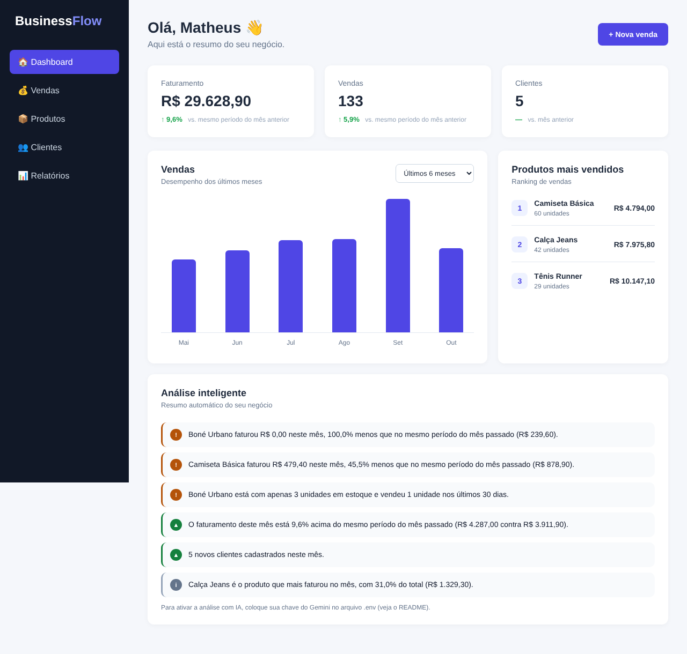
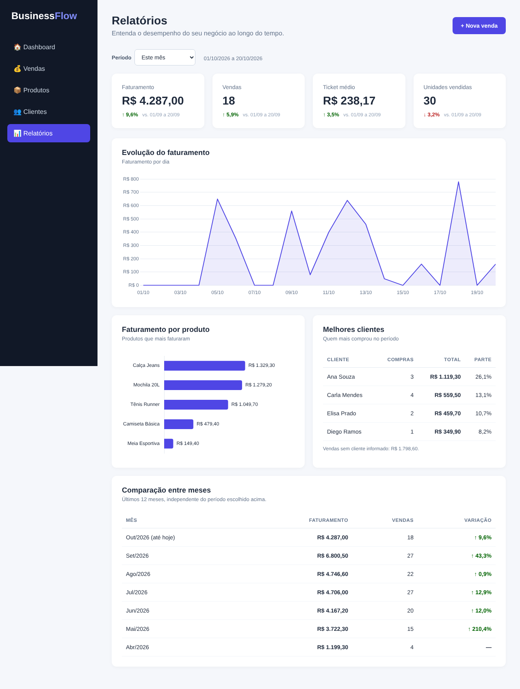
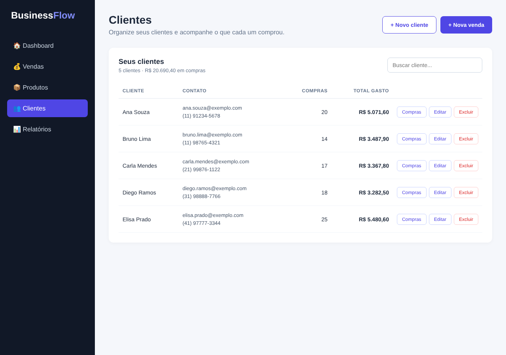

# BusinessFlow

Painel de vendas para pequenos negócios, que transforma o registro de vendas em indicadores, relatórios e análises automáticas (com IA opcional).

> Projeto de portfólio. Os dados dos prints são **fictícios** (gerados por `seed_demo.py`).



## O problema

Muitos pequenos comerciantes controlam vendas em planilhas ou anotações e acabam sem enxergar faturamento, produtos que mais vendem ou tendência de crescimento. O BusinessFlow reúne isso em uma interface simples e calcula os indicadores automaticamente.

## Funcionalidades

- **Dashboard:** faturamento, vendas e clientes comparados ao mesmo período do mês anterior, gráfico dos últimos 6 meses, ranking de produtos e análise inteligente.
- **Vendas:** cadastro rápido (modal "Nova venda"), histórico e exclusão, com cliente opcional.
- **Produtos:** CRUD completo com controle de estoque.
- **Clientes:** CRUD com validação de e-mail/telefone, total de compras e valor gasto.
- **Relatórios:** filtro por período, evolução do faturamento, faturamento por produto, melhores clientes e comparação mensal.
- **IA (Gemini):** análise em texto do negócio. Sem chave, o painel usa insights calculados por regras.

| Relatórios | Clientes |
|---|---|
|  |  |

## Arquitetura

```
Navegador (HTML/CSS/JS, Chart.js)
        │  fetch (JSON)
        ▼
Flask (app.py)  ──►  insights.py ──► API do Gemini (opcional)
        │
        ▼
SQLite (database.db): vendas, produtos, clientes, analises_ia
```

- Templates Jinja com herança (`base.html`).
- API REST em `/api/vendas`, `/api/produtos`, `/api/clientes`, `/api/insights`.
- Validação no servidor (400/404/409) e dados exibidos com `textContent` no front-end.
- Migrações simples do SQLite no início da aplicação.

## Como rodar

```bash
pip install -r requirements.txt
python seed_demo.py        # opcional: dados de exemplo
python app.py
```

Abra http://127.0.0.1:5000 (execute dentro da pasta do projeto).

## Ativar a IA (Gemini, gratuito)

1. Crie uma chave em https://aistudio.google.com/apikey
2. Copie `.env.example` para `.env` e cole a chave em `GEMINI_API_KEY`.
3. `python testar_gemini.py` confere chave e modelo.
4. Reinicie e clique em **Gerar análise com IA** no Dashboard.

Se o modelo padrão não estiver disponível para você, defina `GEMINI_MODEL` no `.env`.

### Privacidade
- A chave fica só no servidor (`.env` está no `.gitignore`).
- O Gemini recebe apenas números agregados e nomes de produtos, nunca dados de clientes.
- No plano gratuito a Google pode usar o conteúdo enviado para melhorar seus produtos: evite dados sensíveis.

## Estrutura

```
app.py           rotas e banco
insights.py      fatos, regras e cliente Gemini
seed_demo.py     dados fictícios
templates/       páginas (Jinja)
static/          css e js (Chart.js local)
docs/            prints
```

## Próximos passos

- [ ] Login e contas por empresa
- [ ] Migração para PostgreSQL
- [ ] Deploy
